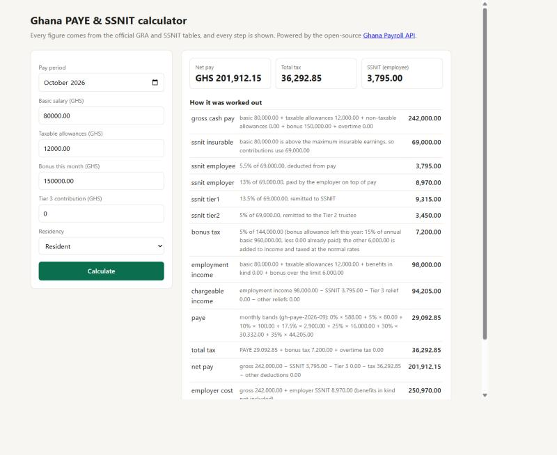
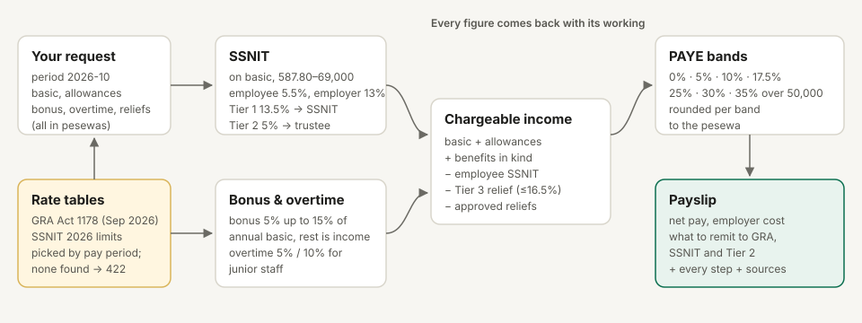

# Ghana Payroll API

PAYE, SSNIT and net pay for Ghana, calculated exactly from the official GRA and SSNIT rate tables and explained line by line.

[](https://github.com/Jacksonoseikojo1122/ghana-payroll-api/actions/workflows/ci.yml)

Small businesses and HR tools in Ghana still work out payroll in spreadsheets. Tax bands change (they changed again on 1 September 2026), and a wrong formula costs money and trust. This API does the sums the way GRA and SSNIT publish them. It shows every step, and it tells you which official table it used.


## What it does

- **PAYE** with the current graduated bands (Act 1178), plus the GRA rules for bonus, junior-staff overtime, non-residents and casual workers.
- **SSNIT** on basic salary within the 2026 limits: employee 5.5%, employer 13%, and the Tier 1 / Tier 2 split for remittance.
- **Every step shown**, in `working`. Each result also lists the rate tables used, with links to the official GRA and SSNIT documents.
- **Exact money**: integer pesewas end to end, rounded half up per band, so the band rows always add up to the total.
- **Versioned rate tables** in [`/rates`](rates). Each table has an effective date and a source. Periods with no official table get `422` instead of a guess.
- **Gross-up**: "what basic salary gives GHS 5,000 net?"
- **Payroll runs** for up to 1,000 employees, stored with **idempotency keys** so a retry never doubles a run, plus a CSV export.
- A one-page **calculator** at `/`.



## Quick start

```bash
git clone https://github.com/Jacksonoseikojo1122/ghana-payroll-api.git
cd ghana-payroll-api && npm install
npm start   # http://localhost:8788
```

```bash
curl -X POST http://localhost:8788/v1/payslip -H "content-type: application/json" \
  -d '{"period":"2026-10","basic_salary":500000,"allowances":[{"name":"Transport","amount":100000}]}'
```

Amounts are pesewas: `500000` is GHS 5,000.00. The answer includes `net_pay: 468925` (GHS 4,689.25), the PAYE band by band, SSNIT Tier 1 and Tier 2, and the working.

## Docs

| | |
| --- | --- |
| [Getting started](docs/getting-started.md) | Install, first payslip, gross-up, payroll runs, configuration |
| [Integration guide](docs/integration.md) | Node.js, Python and PHP clients, and what each field means |
| [How it works](docs/how-it-works.md) | Every rule, step by step, with rounding |
| [Rate tables](docs/rates.md) | Official sources, how tables are versioned, known gaps |
| [OpenAPI spec](openapi.yaml) | Every endpoint and field |
| [llms.txt](llms.txt) | A summary for AI assistants helping you integrate |
| [Example CSV](docs/example-payslips.csv) | Output of a real three-person run |



## Sources

- GRA, [Amendments: Income Tax Act, 2026 (Act 1178)](https://gra.gov.gh/wp-content/uploads/2026/09/Amendments-To-The-Income-Tax-2015-Act-896_Updated-1.pdf), effective 1 September 2026
- GRA, [Pay As You Earn](https://gra.gov.gh/domestic-tax/tax-types/paye/)
- SSNIT, [Public notice on 2026 minimum and maximum insurable earnings](https://www.ssnit.org.gh/wp-content/uploads/2026/01/Public-Notice-Min-Max-Insurable.pdf)
- SSNIT, [The new pension scheme](https://www.ssnit.org.gh/faq/the-new-pension-scheme)

This is arithmetic from published rules, not tax advice. Check unusual cases with GRA or a tax adviser. If you spot a rule that's wrong or out of date, please open an issue with the official source.

## Author

Built by **[Jackson Kojo Osei](https://jacksonkojoosei.com)**, CTO in Accra, Ghana.
[LinkedIn](https://www.linkedin.com/in/jackson-kojo-osei-740846189) · [Project page](https://jacksonkojoosei.com/projects/ghana-payroll-api) · [All projects](https://jacksonkojoosei.com/projects)

## License

MIT
