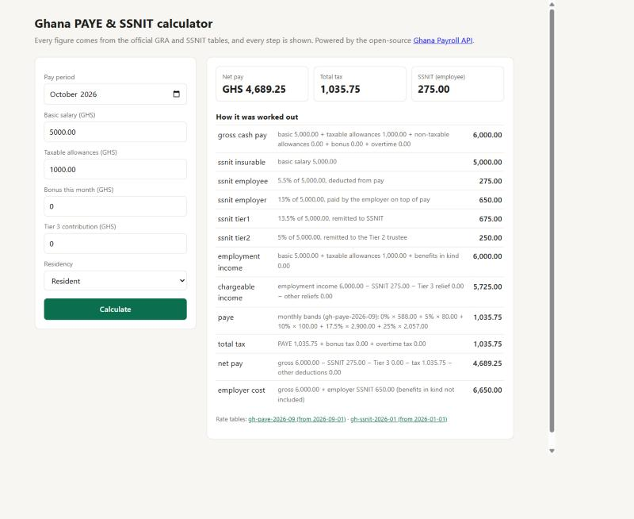

# How the Ghana Payroll API works it out

Every payslip follows the same steps, and every step is returned in `working` so you (or an auditor) can check it.



## 1. Money and rounding

- All amounts are **integer pesewas**. GHS 1,234.50 is `123450`. No floating point anywhere.
- Rates are basis points: 17.5% is `1750`.
- Every percentage is rounded **half up to the nearest pesewa**.
- PAYE is rounded **per band**, so the band rows in `tax.bands` always add up to `tax.paye`.
- SSNIT rounds the 18.5% total once. The employer share and Tier 1 are then whatever is left, so employee + employer always equals Tier 1 + Tier 2.

## 2. Pick the rate tables

The pay `period` (YYYY-MM) decides which tables apply. For each kind (PAYE and SSNIT), it's the latest table whose `effective_from` is on or before the first day of the period. If there's no official table for that date, the API answers **422 `no_rate_table`** instead of guessing. See [rates.md](rates.md).

## 3. SSNIT (National Pensions Act, 2008, Act 766)

| | Rate | Of |
| --- | --- | --- |
| Employee (deducted from pay) | 5.5% | insurable earnings |
| Employer (on top of pay) | 13% | insurable earnings |
| Tier 1, remitted to SSNIT | 13.5% | insurable earnings |
| Tier 2, remitted to the trustee | 5% | insurable earnings |

**Insurable earnings** are the **basic salary**, kept within SSNIT's limits for the year. For 2026 those are GHS 587.80 to GHS 69,000.00 a month. Allowances, bonus and overtime don't count.

## 4. Bonus

For residents, bonus is taxed at **5%**, up to 15% of the employee's annual basic salary for the year. Bonus already paid earlier in the year (`bonus_paid_earlier_this_year`) uses up part of that limit. Anything over the limit is added to employment income and taxed at the normal rates. `annual_basic_salary` defaults to basic × 12.

## 5. Overtime

Overtime rates only apply to junior staff whose qualifying income for the year is at most GHS 18,000. `annual_qualifying_income` defaults to (basic + taxable allowances) × 12. Those employees pay:

- **5%** on overtime up to 50% of monthly basic salary;
- **10%** on the rest.

Above the limit, the overtime is added to normal income, and the response includes a warning.

## 6. Chargeable income and PAYE

```
employment income = basic + taxable allowances + benefits in kind + bonus over the limit (+ overtime if not eligible)
chargeable income = employment income − employee SSNIT − Tier 3 relief (max 16.5% of basic) − other reliefs
```

PAYE is the monthly graduated table applied to chargeable income. From 1 September 2026 (Act 1178):

| Chargeable income (monthly) | Rate |
| --- | --- |
| First GHS 588 | 0% |
| Next GHS 80 | 5% |
| Next GHS 100 | 10% |
| Next GHS 2,900 | 17.5% |
| Next GHS 16,000 | 25% |
| Next GHS 30,332 | 30% |
| Above GHS 50,000 | 35% |

## 7. Non-residents and casual workers

- **Non-resident** (`residency: "non_resident"`): PAYE is a flat 25% of chargeable income. Bonus and overtime are taxed at 20%.
- **Casual workers** (`employment: "casual"`): a flat 5% of the amount paid. Reliefs don't apply.

## 8. Net pay and employer cost

```
net pay       = gross cash pay − employee SSNIT − Tier 3 contribution − total tax − other deductions
employer cost = gross cash pay + employer SSNIT
```

Benefits in kind are taxed but aren't cash, so they're not in gross cash pay or net pay. Allowances marked `taxable: false` are paid but not taxed. Use that only for real exemptions such as reimbursed expenses; the response warns when you do.

## What it doesn't do (yet)

- Personal reliefs that GRA grants on application (marriage, children's education, old age, disability) aren't applied automatically. If GRA has approved one, pass it in `reliefs` with its monthly amount.
- Annual PAYE reconciliation and the GRA filing format.
- Pay periods before 1 September 2026. See [rates.md](rates.md#known-gaps).

This API does arithmetic from published rules. It isn't tax advice. Check unusual cases with GRA or a tax adviser.
